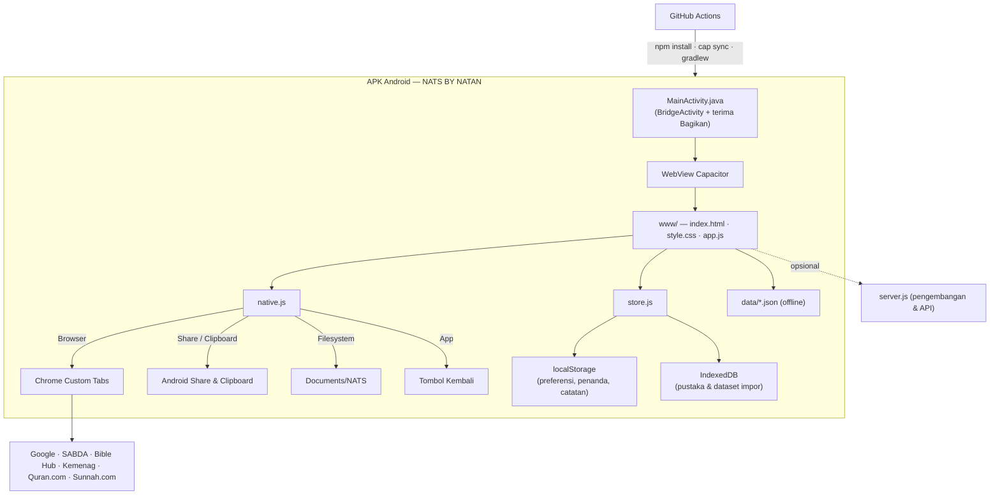
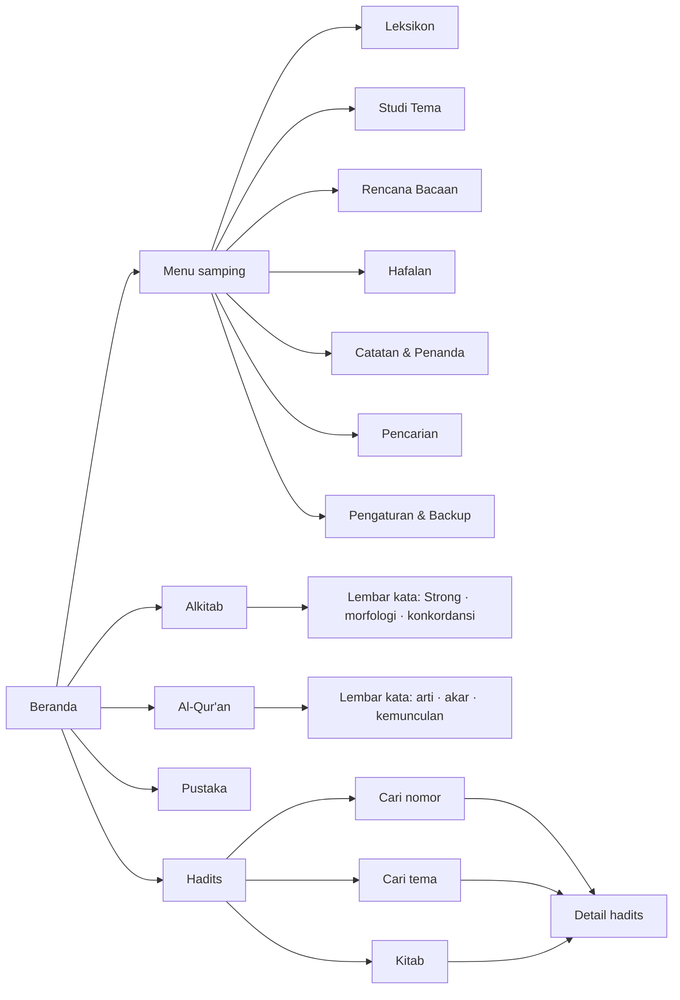

# Dokumen Perancangan — NATS BY NATAN

**Platform:** Android 6.0+ (minSdk 23, target SDK 35) · **Paket:** `com.natan.nats` · **Versi:** 1.0.0

## 1. Tujuan
Satu aplikasi HP untuk pembelajaran agama dan keimanan yang menyatukan kekuatan empat aplikasi rujukan:

| Rujukan | Yang diadopsi di NATS |
|---|---|
| Alkitab SABDA | banyak terjemahan yang bisa dipilih, catatan studi, referensi silang, penanda/stabilo/catatan, rencana baca |
| Bible Hub | interlinear kata per kata, nomor Strong, morfologi, leksikon & konkordansi, bandingkan terjemahan |
| Qur'an Kemenag | teks Arab, Latin, terjemahan Kemenag, tafsir ringkas, audio murottal, daftar surah |
| Ensiklopedia Hadits | 9 kitab imam, cari nomor & tema, derajat, perawi, bab, syarah, faidah, takhrij |

Ditambah fitur baru: Perpustakaan Digital, pencarian terhubung Chrome, Studi Tema lintas kitab, Hafalan, dan backup.

## 2. Arsitektur



- **Capacitor 7** menjadi penghubung aplikasi web dengan Android. Seluruh UI dibundel di APK sehingga berjalan tanpa internet; internet hanya untuk audio murottal, font web, dan pencarian Chrome.
- **Tanpa framework/bundler** — HTML, CSS, JS murni agar ringan di HP kelas menengah.
- **server.js** tidak dibutuhkan aplikasi; dipakai untuk pratinjau, API JSON, dan pustaka bersama opsional.

## 3. Peta layar & navigasi



Navigasi bawah 5 tab (Beranda, Alkitab, Al-Qur'an, Hadits, Pustaka) + menu samping untuk fitur lain + tombol cari di bilah atas. Interaksi detail memakai *bottom sheet* yang bisa digeser turun. Tombol Kembali Android: tutup sheet → kembali halaman → keluar.

## 4. Spesifikasi tampilan ayat (sama untuk Alkitab & Al-Qur'an)

```
┌───────────────────────────────────────────┐
│ (16) Yohanes 3:16                      ⋯  │  nomor + referensi + menu
│                                            │
│  Οὕτως γὰρ ἠγάπησεν ὁ θεὸς τὸν κόσμον …   │  TEKS ASLI (Ibrani/Arab RTL, Yunani LTR)
│                                            │  setiap kata bisa diketuk
│  Houtōs gar ēgapēsen ho theos …           │  TRANSLITERASI (miring)
│  ─ ─ ─ ─ ─ ─ ─ ─ ─ ─ ─ ─ ─ ─ ─ ─ ─ ─ ─   │
│  [NATS] Karena Allah sangat mengasihi …    │  TERJEMAHAN 1..n (dipilih lewat chip)
│  [KJV]  For God so loved the world …       │
│  ▸ Catatan studi / Tafsir ringkas          │
│  ↗ Roma 5:8   ↗ 1 Yohanes 4:9             │  referensi silang
│  ☆   🖍   ✎   ⧉   ⤴   ▶                   │  penanda·stabilo·catatan·salin·bagikan·audio
└───────────────────────────────────────────┘
```
Mode **Interlinear** mengganti baris teks asli menjadi kotak per kata: `G25 / ἠγάπησεν / ēgapēsen / mengasihi / Verba Aor Ind Akt 3 Tunggal`. Font: Frank Ruhl Libre (Ibrani), GFS Didot (Yunani), Amiri (Arab), Plus Jakarta Sans (UI), Fraunces (judul); cadangan font Noto bawaan Android saat offline.

## 5. Modul & fitur

### 5.1 Alkitab
66 kitab (PL Ibrani, PB Yunani) · pemilih kitab & pasal (penanda “✓ data” untuk pasal yang tersedia) · terjemahan multipilih · paralel/interlinear · leksikon Strong & konkordansi · referensi silang · catatan studi · bandingkan semua terjemahan · tautan Bible Hub (interlinear, paralel, Strong) & SABDA · TTS terjemahan · navigasi pasal antar-kitab.

### 5.2 Al-Qur'an
114 surah dengan pencarian · basmalah otomatis (kecuali At-Taubah & Al-Fatihah) · Arab + Latin + terjemahan (Kemenag, dll.) · kata per kata dengan akar kata & i'rab · kemunculan akar · tafsir ringkas · murottal per ayat/satu surah dengan sorotan ayat aktif, 5 qari · tautan Quran.com, Quranic Corpus, Kemenag.

### 5.3 Ensiklopedia Hadits 9 Imam
Sumber teks: **Hadith API GadingDev** (`/books`, `/books/{kitab}?range=a-b` maks 300, `/books/{kitab}/{nomor}`), dipanggil lewat HTTP native Capacitor (bebas CORS) dan disimpan di IndexedDB `hadith` (cache + unduh kitab penuh). Pencarian kata & tema berjalan di cache offline; catatan studi NATS ditempel hanya bila teks Arab cocok.

Kitab: Bukhari, Muslim, Abu Dawud, Tirmidzi, Nasa'i, Ibnu Majah, Ahmad, Malik, Darimi.
- **Cari nomor:** pilih kitab (dropdown 9 kitab) + nomor → validasi batas jumlah hadits kitab
- **Cari tema:** chip tema → daftar hadits lintas kitab
- **Cari kata:** Arab, terjemah, perawi, bab
- Detail: kitab & bab, derajat berwarna (Shahih/Hasan/lainnya), perawi, matan Arab, Latin, terjemah, tab **Syarah · Faidah · Takhrij · Tema · Catatan**, sebelum/sesudah. Nomor yang belum ada offline menampilkan opsi impor & cari di Chrome.

### 5.4 Perpustakaan Digital
Jenis: PDF, website/link, catatan, gambar, teks, file lain (docx, pptx, epub, audio). Folder & tag, pencarian, penampil PDF internal (pdf.js, zoom), ekspor ke `Documents/NATS`, bagikan, terima kiriman dari Chrome (*Bagikan → NATS*) dan PDF dari aplikasi lain, simpan ayat/hadits sebagai catatan, indikator penyimpanan terpakai.

### 5.5 Pencarian
1) **Di aplikasi** — satu kotak untuk ayat, hadits, leksikon, pustaka, catatan; deteksi referensi (`Kej 1:3`, `Yohanes 3`). 2) **Di Chrome** — mesin (Google, Bing, DuckDuckGo, Scholar, YouTube, Wikipedia) + filter situs (SABDA, Bible Hub, Kemenag, Quran.com, Hadits.id, Sunnah.com, Wikipedia ID), riwayat pencarian, simpan link hasil ke Pustaka.

### 5.6 Fitur pendukung
Leksikon (Ibrani/Yunani/akar Arab) · Studi Tema lintas kitab · Rencana Bacaan dengan progres · Hafalan (flashcard 3 tahap: asli → translit → terjemahan, level naik/turun) · Catatan/Penanda/Stabilo/Riwayat · Bacaan Hari Ini · Impor dataset · Backup/pulihkan (JSON berisi preferensi, pustaka + file base64, dataset) · 4 tema warna · ukuran huruf.

## 6. Model data
| Penyimpanan | Isi |
|---|---|
| `www/data/bible.json` | `translations[]`, `verses["GEN.1"] = [{v, orig, translit, tr{}, words[[asli, translit, glosa, strong, morf]], xref[], note}]` |
| `www/data/quran.json` | `translations[]`, `surah["1"] = [{v, orig, translit, tr{}, words[[arab, translit, arti, akar, ket]], tafsir}]` |
| `www/data/hadith.json` | `kitab[9]`, `themes[]`, `items[kitab] = [{no, bab, perawi, arab, translit, terjemah, derajat, tema[], takhrij[[kitab,no]], syarah, faidah[]}]` |
| `www/data/lexicon.json` | `strong{H…/G…}`, `roots{akar}` |
| `www/data/topics.json` | tema lintas kitab & rencana bacaan |
| localStorage `nats.v1` | preferensi, penanda, catatan, stabilo, riwayat, hafalan, progres rencana |
| IndexedDB `nats-db` | `library` (item + Blob file), `datasets` (JSON impor) |

Kunci universal: `B:GEN.1.1` · `Q:1.1` · `H:bukhari:1`.

## 7. Integrasi native (Capacitor)
| Plugin | Kegunaan |
|---|---|
| `@capacitor/browser` | membuka pencarian & situs di Chrome Custom Tabs |
| `@capacitor/app-launcher` | membuka di aplikasi eksternal |
| `@capacitor/share` | bagikan ayat/hadits/pustaka |
| `@capacitor/clipboard` | salin ayat & kata |
| `@capacitor/filesystem` | ekspor file & backup ke Documents/NATS |
| `@capacitor/app` | tombol Kembali, keluar aplikasi |
| `@capacitor/camera` | impor banyak foto dari Galeri, ambil foto, izin foto/media |
| `CapacitorHttp` (bawaan) | memanggil API hadits GadingDev tanpa batasan CORS |
| `MainActivity.java` | intent `ACTION_SEND` (text/plain & application/pdf) → event `natsShare` |

## 8. Build & rilis
`.github/workflows/android-build.yml`: Node 20 → JDK 21 → Android SDK → `npm install` (+ salin pdf.js) → validasi data → lengkapi modul Capacitor → `npx cap sync android` → keystore (Secrets atau sementara) → `./gradlew assembleDebug assembleRelease bundleRelease` → artefak APK/AAB + master backup ZIP → GitHub Release otomatis untuk tag `v*`.

## 9. Privasi & keamanan
Semua catatan dan pustaka hanya disimpan di HP. Tidak ada akun, iklan, atau pelacak. Izin: Internet, status jaringan, dan penyimpanan (hanya Android ≤ 9/12 untuk ekspor). WebView debugging dimatikan pada rilis.

## 10. Peta jalan
1. Paket dataset lengkap siap impor (WLC+morfologi, SBLGNT, Strong's lengkap, 6.236 ayat Al-Qur'an + per kata, 9 kitab hadits).
2. Sinkronisasi antar-perangkat via `server.js` / layanan awan.
3. Mode audio Alkitab, pembacaan teks Ibrani/Yunani.
4. Anotasi langsung di PDF dan penanda halaman.
5. Widget layar beranda “Bacaan Hari Ini” & notifikasi pengingat rencana baca.
